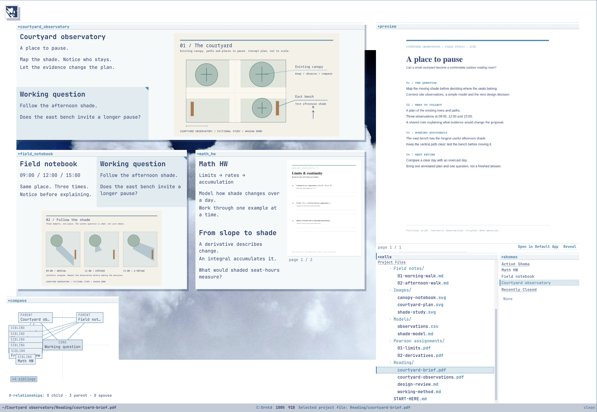

# Akasha user manual

**A practical guide to the current personal alpha · checked 28 October 2026.**

Use this guide while working. Start with [First session](#first-session), then jump to a task. For the design rationale, read the [introduction](index.md). For exact semantics, architecture, compatibility notes, and LLM context, use the [comprehensive reference](reference.md).

## Find a task

- [First session](#first-session)
- [Understand the screen](#understand-the-screen)
- [Write and arrange notes](#write-and-arrange-notes)
- [Reuse one note in several places](#reuse-one-note-in-several-places)
- [Create relationships](#create-relationships)
- [Work with files and folders](#work-with-files-and-folders)
- [Connect a folder to a subject](#connect-a-folder-to-a-subject)
- [Make a note from a source](#make-a-note-from-a-source)
- [Link, embed, and extract a passage](#link-embed-and-extract-a-passage)
- [Find material through relationships](#find-material-through-relationships)
- [Change the appearance](#change-the-appearance)
- [Save, undo, and recover](#save-undo-and-recover)
- [Resolve a problem](#resolve-a-problem)
- [Keyboard reference](#keyboard-reference)

## First session

1. Open the installed Akasha desktop app. The Linux AppImage runs without Node.js.
2. Press **Ctrl+O** and choose a project folder. A small folder with a few documents is a good start. Akasha creates a `.akasha` directory for its state and native notes.
3. Click the canvas, press **n**, then **e** to edit the new note. Replace the starter text with a short heading and a sentence explaining the project.
4. Press **Esc** to return to spatial work. If a completion popup is open, the first Esc dismisses it.
5. In **+cells**, click a file to inspect its preview. Press **Enter** to open its own Shoma.
6. Press **Ctrl+S** to save. Check the modeline for a successful save rather than assuming a save attempt succeeded.

The repository includes a prepared example at `demo-projects/courtyard/Courtyard observatory`. Open that folder to explore the workspace shown below. It contains fictional research materials, images, assignments, and a shared question. At smaller window sizes, use Ctrl+wheel to zoom out.

## Understand the screen

| Part | What to use it for |
|---|---|
| **Canvas** | Arrange and navigate Shoma windows. |
| **Shoma** | Work with a set of Cell placements around a central subject. |
| **+editor** | Edit the focused native note. |
| **+preview** | Inspect a file-backed source without editing it. |
| **+cells** | Find native Cells and project files; run file commands. |
| **+shomas** | Activate open views and reopen recently closed ones. |
| **+compass / +constellation** | Explore relationships. |
| **Bottom modeline** | Check focus, mode, zoom, save state, and command feedback. |
| **Top-left Akasha icon** | Open projects, recovery, folder connections, and theme controls. |

Remember three distinctions:

- **Cell:** the thing itself. Editing it affects every view of that identity.
- **Placement:** where that Cell appears. Moving or styling a placement is local to that appearance.
- **Relationship:** why Cells belong together. Proximity alone does not create one.

Shortcuts depend on focus. **n** creates a native note on the canvas but opens a filesystem-create prompt in **+cells**. **Ctrl+A** selects text in the editor and visible Cells on the canvas. Click the intended area first.

## Write and arrange notes

Create a standalone note with **n**. To create beside a focused Cell, clear any selection with **Shift+Space**, choose a placement mode, then press **Ctrl+direction**. Use arrows or `h` left, `j` down, `k` up, `l` right. Directional creation may enter the editor immediately.

For layout without a new relationship, press **r** for **Oriented**, then use Ctrl+direction. For a new child of the Shoma's core, choose **Bound** with **y** and create downward.

Drag a Shoma by its header. Resize from its edges or corner. Drag an internal divider to change the relative size of Cells. Wheel pans; Ctrl+wheel zooms. **0** resets the canvas viewport. **q** closes the active Shoma window without deleting its Cells.

Use **m** for move mode, choose a destination with direction keys, and use Ctrl+direction to place. Use **f** for boundary folding, choose and confirm the boundaries, and **u** to unfold. Esc leaves the active layout mode. Folding is for hiding a region of layout, not deleting information.

Markdown writing supports headings, lists, emphasis, links, and code. Enter continues a real list; Enter on an empty list item exits it. Tab and Shift+Tab indent and outdent actual list structures. Akasha is not an Org-mode implementation.

## Reuse one note in several places

To place an existing Cell beside a different Cell:

1. Focus the Cell to reuse and press **Space** to select it.
2. Focus a destination Cell that is **outside** the selection.
3. Press **r** for Oriented placement if no new relationship is wanted.
4. Press **Ctrl+direction** to place the selected identity beside the destination.
5. Clear selection with **Shift+Space**.

If focus is inside the selection, Ctrl+direction has a different meaning: it can create one new shared Cell off the selected anchors. Clear selection before ordinary creation if that is not your intention.

For larger patterns, copy a focus/selection bundle with **Ctrl+C**, then **Ctrl+V** on the canvas. The paste chooser offers reuse, duplication, and custom per-Cell choices. **Same Cells / visual instance** retains identity. **New Structure** is the explicit choice for copied local relationships. **Custom per Cell** lets you choose same, new, or skip and control relationship copying.

Pasting into a focused slot is a replacement operation and can adopt its local role; it is not merely dropping a new card beside it. For simple reuse, the selection-placement recipe above is easier to reason about. The current “New Cells / content only” label also understates relationship copying in the implementation; see the reference before relying on it for relationship-free copies.

## Create relationships

Use relationships when the connection should survive a change of layout.

| Mode | Key | Use it when… |
|---|---|---|
| Oriented | `r` | You only want to arrange a Cell. |
| Bound | `y` | The new Cell should relate to the Shoma's core. |
| Orbital | `o` | It should relate to both the core and the current focus. |
| Drifting | `d` | It should relate through a non-core focused Cell. |
| Inscription | `i` | You want a local annotation rather than a global Cell. |

In relationship-producing actions, up means parent, down means child, and sideways means spouse. The reference point depends on the mode. To inspect the result, use Compass or the direct relationship marks in +cells: **⇧ parent**, **⇩ child**, **≖ spouse** relative to focus.

You can also select existing Cells, focus another Cell, and use its context menu: **Marriage / spouse**, **Adoption / selected children**, or **Birth / selected parents**. Selection is temporary attention, not a permanent group.

## Work with files and folders

Click a project row in **+cells** to select and preview it; **Enter** or **Shift+O** opens its Shoma. **Tab** expands or collapses a folder. **Open in Default App** and **Reveal** act on the real source.

| Task in +cells | Action |
|---|---|
| Create an empty file | Press `n`, enter `note.md`, confirm with Enter. |
| Create a folder | Press `n`, enter `references/`, confirm. |
| Rename | Focus a live row, press `r`, enter the new basename. |
| Move up one folder | `Alt+h`. |
| Choose a destination folder | `Alt+l`, select with `j/k`, confirm with Enter. |
| Reveal in the file manager | `Alt+Enter`. |
| Open externally | `Shift+Alt+Enter`. |

Creation happens inside a selected folder, beside a selected file, or at the project root when no project row supplies a location. A name without a conventional extension also creates a folder; use an extension when you mean a file.

Rename and move preserve Cell identity when performed through Akasha. Collisions and unsafe destinations are refused. Folder moves/renames with backed descendants are currently refused. Successful filesystem rename/move clears structural undo rather than pretending disk changes can be safely undone as an ordinary layout edit.

External additions are discovered while the project is open. Use **Refresh Project Files** if discovery lags. Discovery does not automatically place every file on your canvas.

## Connect a folder to a subject

1. Create a native note called **Math HW**.
2. In +cells, right-click **Pearson assignments** and choose **Connect contents…**.
3. Choose Math HW and **Parent of the files**.
4. Enable **Include subfolders** if wanted, then connect.
5. Add a PDF to the folder. It becomes a child of Math HW, while its placement remains your choice.

Manage connections through **Akasha icon → Folder connections…**.

| Control | Effect |
|---|---|
| Exclude | Stops this instruction linking one file. Other support survives. |
| Include again | Allows the file to participate in this instruction again. |
| Keep independently | Keeps the relationship beyond this folder instruction. |
| Remove connection | Removes that instruction's support, not independently kept facts. |

Rules include ordinary files, not folders themselves. There is no extension filter yet. If a file disappears, its identity and last known connections are retained as unavailable. Explicitly moving or rebinding it outside the folder removes this rule's support. An external rename is not automatically recognized as the same file.

## Make a note from a source

1. Select a source in +cells and press Enter to open its Shoma.
2. In a text preview, optionally select the passage you want to quote.
3. Press **Ctrl+Shift+Enter** from the preview or source-focused canvas.
4. Write below the source link or quotation in the new native note.

The source becomes the note's parent. The source file is unchanged. This works for a general note about a PDF or image too, but does not create a PDF text anchor or an image-region selection.

**Context matters:** the same shortcut inside the native editor is an Anchor Group command, not the source-note command. Select the preview or source Cell first.

## Link, embed, and extract a passage

| Write | Result |
|---|---|
| `[[Working question]]` | Link to a Cell. |
| `![[Working question]]` | Read-only projection of the Cell. |
| `[[Field notes#Afternoon]]` | Link to a subject inside a native note. |
| `![[Field notes#Afternoon]]` | Project that subject. |
| `![[notes.md#L3-L8]]` | Project inclusive lines from a project text file. |

To display a shorter label, use an alias: `[[Working question|question]]`.

Choose autocomplete results rather than guessing when titles are ambiguous. **Enter in a wiki-link popup completes a reference. Enter in an active normal Automatch popup can merge identities.** Esc dismisses the popup when you only want to continue writing.

A standalone plain `[[Cell]]` line does not create a graph relationship. Inline references and ordinary embeds contribute textual spouse/reference facts. A file line-range embed gives the containing note a source-parent relationship. Layout hierarchy is not inferred from indentation beneath a link.

In native writing, **Alt+S** spatializes the active text subject, or an Anchor Group for multiple meaningful selected lines. A dedicated Shoma opens; the source text stays intact. **Alt+C** copies the current subject's stable reference. Multiline group-copy references are not implemented. Use the anchor actions to promote content when you need an independent copy rather than a live projection.

In an external text preview, select lines and use **Alt+S** or **Spatialize Lines**. This makes a native wrapper referring to those line numbers. Inserting lines into the source later can change what that range means; it is not a semantic passage tracker.

## Find material through relationships

Use **Compass** for the focused Cell's immediate context. Click related subjects to navigate. Use **Constellation** for broader scopes: focus, Shoma, whole Akasha, or selection. These are derived views, not new collections of Cells.

For a relationship-pattern query, focus a pattern Cell and use **Shift+Q**. Constraints come from relevant relationships and supported text references. With no usable pattern, the query falls back to neighbors/backlinks. Results refer to existing identities. **p** pins a focused result; **Shift+P** pins the currently visible results into the host layout. Pinning does not automatically give them the host's relationships.

A useful pattern might mean “a child of this project, associated with this topic.” This is structured matching, not natural-language search or automatic understanding of PDF contents.

## Change the appearance

Open **Akasha icon → Theme / Surfaces**. Set colors, font, tone, and visual treatment. Choose a canvas background image if wanted. Create a custom surface to adjust its background, opacity, blur, and padding; choose defaults or assign styles to individual appearances through their controls.

| Setting | Lifetime |
|---|---|
| Theme colors, fonts, treatment, saved custom surface definitions/defaults | Saved with the Akasha project. |
| Global shadow choice, header visibility, border width, Shoma gap, named session preset | Current session. |
| Selected canvas background image | Installed app's local configuration; not bundled into the project. |

Built-in surface definitions are protected; make a custom surface to edit those values. Placement-local styles can make two appearances of one Cell look different without changing identity. Styling a divider does not create a relationship.

## Save, undo, and recover

**Ctrl+S** saves; the app also autosaves. Native writing in a folder project lives inside `.akasha/vault.json`, alongside graph and layout state. Back up the entire project, including hidden `.akasha` contents.

**Ctrl+Z** in the editor undoes text. On the canvas it undoes structural work. **Ctrl+Y** or **Ctrl+Shift+Z** redo structural work. These histories are not interchangeable.

**x** trashes a Cell identity and removes its placements across Shomas. **q** only closes a window. To remove just an appearance, use the placement-removal action in the Cell context menu. **Shift+T** restores the latest trash item.

**Bulk-trash limitation:** Shift+X removes selected note bodies from memory, and generic trash restoration does not reconstruct them. Save first; use checkpoint recovery if needed. Trash restoration also does not recreate every removed non-home placement.

For a damaged or unwanted project save:

1. Open **Akasha icon → Project backups…**.
2. Select the project and a checkpoint.
3. Restore to a **new folder**, then open that copy.

Up to 64 sidecar checkpoints are retained. Autosave checkpoint creation is throttled to at most once every five minutes; manual saves checkpoint the prior valid state. This is not the autosave interval and does not provide historical versions of external PDFs/images. Recovery copies their current contents.

## Resolve a problem

| Symptom | Check or action |
|---|---|
| A shortcut does something unexpected | Click the intended zone; close popups and exit modes with Esc; check selection. |
| An unwanted merge happened | Use structural undo on the canvas promptly; inspect the restored draft. |
| A file is missing | Confirm its real path. Use **Ctrl+Alt+S** to explicitly rebind to an unowned live candidate. |
| Rebind says another Cell owns the path | Inspect that owner. Akasha will not silently steal its backing. |
| New files do not appear | Use Refresh Project Files; `.akasha`, `.git`, `node_modules`, `.DS_Store`, and symlinks are excluded. |
| A PDF has no preview | Check the 20 MB limit, password protection, or corruption; open externally. |
| A passage projection changes after source edits | Check anchor resolution or line positions; line ranges are positional. |
| The wrong Cell appears in a title link | Choose the intended autocomplete target or use an app-generated stable reference. |
| Customization disappears after restart | Check whether it is a session-only setting. |
| A board seems gone | Check +shomas / Recently Closed, then reset or zoom the viewport. |
| Saving reports a damaged sidecar | Restore a new copy through Project backups; do not overwrite the damaged file blindly. |

## Keyboard reference

Linux notation. `Direction` means arrows or `h/j/k/l`. Many Mod shortcuts map to Command on macOS, but platform parity is not fully audited.

| Task | Shortcut / context |
|---|---|
| Open / save | `Ctrl+O` / `Ctrl+S` |
| Help | `?` on canvas |
| New note / edit | `n` / `e` or Enter on canvas |
| Open focused Cell's home Shoma | `Shift+O` |
| Close / cycle Shomas | `q` / `[` and `]` |
| Focus neighbor / create directionally | Direction / `Ctrl+Direction` on canvas |
| Select / clear selection | Space or Shift+click / `Shift+Space` |
| Select visible / cycle selected | `Ctrl+A` / Tab, Shift+Tab on canvas |
| Copy / paste structure | `Ctrl+C` / `Ctrl+V` on canvas |
| Move / border / fold mode | `m` / `b` / `f`; Esc exits |
| Unfold | `u` |
| Query / pin / pin all | `Shift+Q` / `p` / `Shift+P` |
| Source-context note | `Ctrl+Shift+Enter` from source preview/canvas |
| Spatialize / copy native anchor | `Alt+S` / `Alt+C` in editor |
| Trash Cell / selected Cells / restore | `x` / `Shift+X` / `Shift+T` on canvas |

For advanced aliases, precise paste behavior, model invariants, source lifecycles, and the implementation map, continue with the [comprehensive reference](reference.md).
